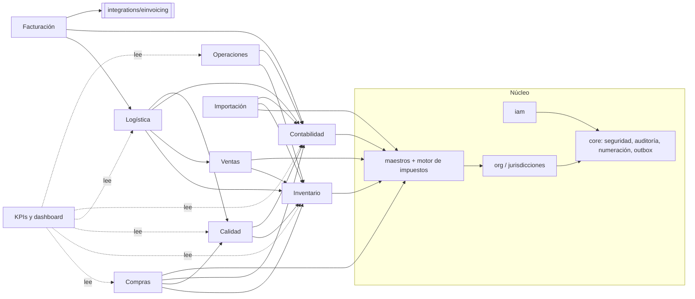

# Arquitectura técnica

## 1. Decisiones que condicionan la solución

| Decisión | Valor adoptado | Origen |
|---|---|---|
| Jurisdicciones | Colombia (DIAN) y Venezuela (SENIAT), por empresa | Usuario |
| Sector inicial | Comercial / distribución (producción activable) | Usuario |
| Proveedor de facturación electrónica | **No definido** → interfaz intercambiable + adaptadores SANDBOX sin validez fiscal | Usuario |
| Topología | Multisede en línea; base central como única fuente de verdad; sin modo offline | Usuario |
| Despliegue | Docker (servidor propio o VM en nube) y Railway | Usuario |
| Costeo de inventario | Promedio ponderado perpetuo por empresa | Hipótesis configurable a futuro |
| Unidades | Transacciones en unidad base del artículo; conversiones al capturar | Hipótesis |
| Inventario negativo | Prohibido (restricción CHECK en BD) | Requisito |
| Autenticación | Local (Argon2id + JWT corto + refresh rotativo) u OIDC corporativo | Hipótesis configurable (`AUTH_MODE`) |

## 2. Estilo arquitectónico

**Monolito modular**: un único proceso FastAPI con módulos de dominio con límites explícitos
(modelos, servicios y router por módulo) y una sola base PostgreSQL. No se usan microservicios: el volumen
esperado (multisede, decenas de usuarios concurrentes) no justifica su coste operativo; los límites entre
módulos permiten extraer servicios más adelante si aparece una necesidad concreta.

```
backend/app
├── core/          configuración, BD, seguridad, auditoría, permisos, numeración, outbox, errores, HTTP
├── modules/
│   ├── iam/         usuarios, roles, permisos, sesiones, auditoría
│   ├── org/         empresas, sedes, monedas, tasas, adjuntos, paquetes por jurisdicción
│   ├── masters/     terceros, artículos, unidades, impuestos (motor de cálculo), validación NIT/RIF
│   ├── purchasing/  solicitud → cotización → OC → recepción → factura proveedor (cruce 3 vías)
│   ├── inventory/   motor de stock (libro + saldos + costos + reservas FEFO), documentos, conteos, kardex
│   ├── quality/     planes, inspecciones, liberación/bloqueo de lotes, NC, CAPA
│   ├── sales/       pedidos, cupo de crédito, reservas
│   ├── logistics/   despacho (picking, packing, envío, entrega), seguimiento, incidencias, devoluciones
│   ├── operations/  órdenes de producción/servicio, BOM, consumos, tiempos, costeo real
│   ├── accounting/  partida doble, reglas de contabilización, periodos, tesorería, conciliación, reportes
│   ├── einvoicing/  facturación de venta, numeración autorizada, envío asíncrono al adaptador
│   ├── kpi/         motor de 53 indicadores, metas, alertas, tendencias
│   └── imports/     plantillas, validación, staging, saldos iniciales aprobados
├── worker.py      proceso de fondo (outbox + alertas)
└── cli.py         administración (init, empresas, usuarios, datos demo)
integrations/einvoicing   contrato EInvoiceAdapter + DIAN (CUFE, UBL 2.1) + SENIAT (imprenta digital) + sandbox
frontend/          React 18 + TypeScript + Vite
```

## 3. Diagrama de módulos y dependencias



Reglas de dependencia: los módulos de negocio dependen del núcleo y de maestros; el inventario y la
contabilidad no conocen a quienes los usan (reciben un `MoveSource` / una clave de idempotencia); los KPI
solo leen. Las integraciones externas no importan el ORM: reciben un `EDocument` neutro.

## 4. Procesos intermodulares (todos en una transacción)

| Evento | Efecto en inventario | Efecto contable (idempotente) | Otros |
|---|---|---|---|
| Recepción de compra | Entrada al costo de la OC (moneda funcional); cuarentena si requiere inspección | Dr Inventario / Cr Recepciones por facturar | Crea inspección |
| Inspección (rechazo) | Salida `supplier_return` | Dr Recepciones por facturar / Cr Inventario | NC automática, lote bloqueado |
| Factura de proveedor | — | Dr Recepciones por facturar (+ variación de precio) + IVA descontable / Cr Retenciones, CxP | Partida por pagar |
| Pago / recaudo | — | Bancos, CxP/CxC, retenciones, IGTF, diferencia en cambio | Aplica partidas |
| Confirmación de pedido | Reserva FEFO (lotes liberados, no vencidos) | — | Control de cupo |
| Envío de despacho | Salida consumiendo reservas (nunca más de lo reservado) | Dr Costo de ventas / Cr Inventario | Seguimiento |
| Emisión de factura | — | Dr CxC / Cr Ingresos, IVA generado | Número autorizado + evento outbox |
| Devolución de cliente | Reingreso al costo original | Dr Inventario / Cr Costo de ventas | NC si llega dañado |
| Orden de producción | Consumo → WIP; producto terminado a costo real | WIP, mano de obra aplicada, variación | — |

## 5. Integridad y concurrencia

- Bloqueo de fila (`SELECT … FOR UPDATE`) en saldos, costos, secuencias, rangos de numeración, partidas y documentos.
  Bloqueos en orden determinista en transferencias para evitar interbloqueos.
- Creación concurrente de filas de control con `INSERT … ON CONFLICT DO NOTHING` (secuencias, saldos, costos).
- Restricciones CHECK (no negativos, reservado ≤ existencia, despachado ≤ preparado ≤ solicitado, etc.).
- Triggers: asiento balanceado (diferido), inmutabilidad contable, bloqueo de periodos cerrados, libros de solo inserción.
- Idempotencia: claves únicas por documento origen en asientos (`company_id, idempotency_key`), pagos
  (`Idempotency-Key` funcional), facturas de proveedor (`supplier_id + número`), eventos outbox.

## 6. Facturación electrónica desacoplada

```mermaid
sequenceDiagram
  participant U as Usuario
  participant API
  participant DB as PostgreSQL
  participant W as Worker
  participant A as Adaptador (sandbox / proveedor)
  U->>API: emitir factura
  API->>DB: número autorizado (FOR UPDATE) + asiento + CxC + evento outbox (1 transacción)
  W->>DB: toma evento (SKIP LOCKED)
  W->>A: submit(EDocument)
  A-->>W: SubmissionResult (accepted/rejected/error, CUFE, nº control)
  W->>DB: intento + XML/JSON conservado (SHA-256) + estado
  Note over W,A: Errores temporales → reintento exponencial; agotado → alerta crítica
```

Estados: `draft → pending → sent → accepted | rejected | error`. `legal_validity` solo es verdadero si el
adaptador es de **producción** y responde aceptación; los adaptadores incluidos son de pruebas.

## 7. Seguridad

Argon2id; JWT de acceso de 15 min; refresh token opaco rotativo con detección de reutilización (revoca todas
las sesiones); bloqueo tras 5 intentos; política de contraseñas; permisos `módulo.recurso.acción`
(read/create/approve/post/void/export/admin); roles por empresa y opcionalmente por sede; segregación de
funciones configurable; límites de aprobación por rol; aislamiento multiempresa en cada consulta y en cada
clave foránea; auditoría automática de cambios + acciones sensibles; límite de solicitudes; cabeceras de
seguridad y CSP; errores sin trazas internas; secretos solo por variables de entorno.

## 8. Observabilidad

Logs JSON con `request_id`, métricas Prometheus (`/metrics`, no expuesto por el proxy), Sentry opcional,
`/health/live` y `/health/ready` (incluye versión de esquema), alertas de integración y de KPIs.

## 9. Topología híbrida (sedes)

La **base central es la única fuente de verdad**. Las sedes se conectan por HTTPS al mismo dominio; los
permisos pueden restringir usuarios a su sede. Si una sede pierde conectividad **no puede registrar
operaciones** (decisión del usuario: sin modo offline). Mitigaciones: doble enlace de internet en sedes
críticas, contingencia documental en papel con numeración controlada y digitación posterior auditada, y
—si en el futuro se exige operación desconectada— una cola local idempotente con identificadores generados
en sede, resolución de conflictos por tipo de documento (inventario: rechazo y ajuste aprobado; numeración
fiscal: rangos asignados por sede) y reconciliación; nunca replicación ciega de bases de datos.
