# Modelo entidad-relación

Diagramas Mermaid generados desde los modelos. Se muestran claves primarias, foráneas y relaciones por dominio (las relaciones hacia tablas de otros dominios se listan al final de cada diagrama).

## Identidad y auditoría

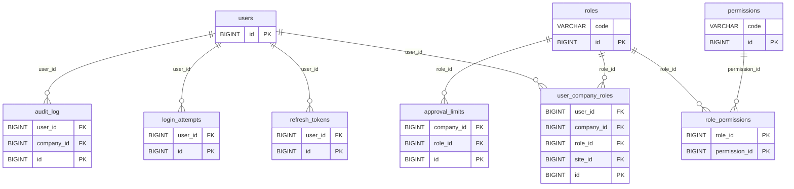

Relaciones con otros dominios: `approval_limits` → companies; `audit_log` → companies; `user_company_roles` → companies, sites.

## Organización y configuración

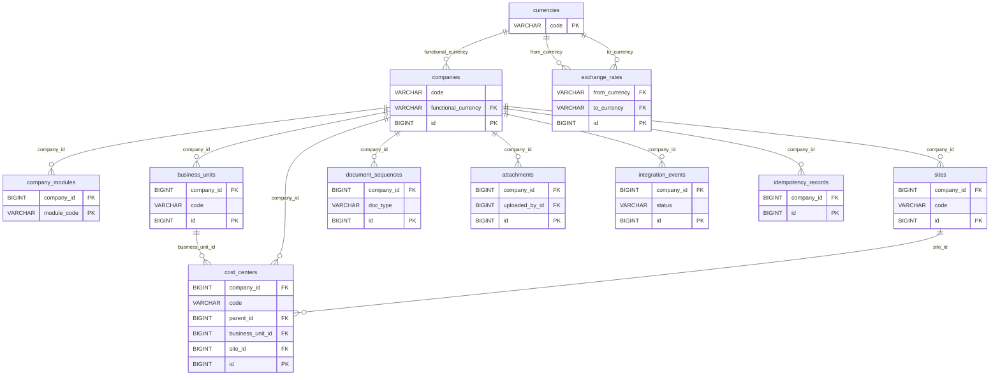

Relaciones con otros dominios: `attachments` → users.

## Datos maestros

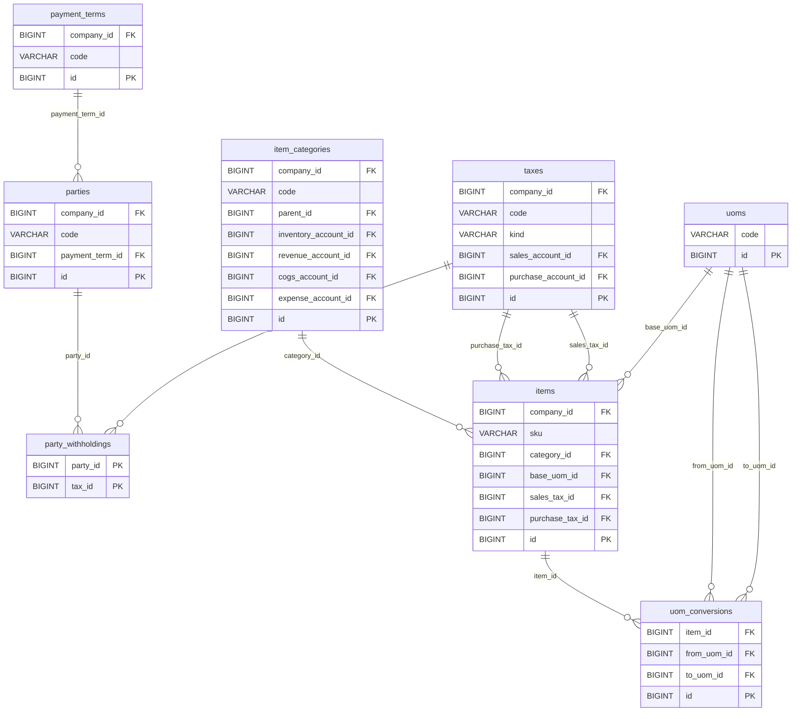

Relaciones con otros dominios: `item_categories` → accounts, companies; `items` → companies; `parties` → companies; `payment_terms` → companies; `taxes` → accounts, companies.

## Compras

```mermaid
erDiagram
    purchase_requisitions {
        VARCHAR number
        BIGINT site_id FK
        BIGINT cost_center_id FK
        BIGINT requested_by_id FK
        VARCHAR status
        BIGINT approved_by_id FK
        BIGINT id PK
        BIGINT company_id FK
    }
    purchase_requisition_lines {
        BIGINT requisition_id FK
        BIGINT item_id FK
        BIGINT id PK
    }
    rfqs {
        VARCHAR number
        BIGINT requisition_id FK
        VARCHAR status
        BIGINT created_by_id FK
        BIGINT id PK
        BIGINT company_id FK
    }
    supplier_quotes {
        BIGINT rfq_id FK
        BIGINT supplier_id FK
        VARCHAR currency FK
        BIGINT payment_term_id FK
        VARCHAR status
        BIGINT id PK
        BIGINT company_id FK
    }
    supplier_quote_lines {
        BIGINT quote_id FK
        BIGINT requisition_line_id FK
        BIGINT item_id FK
        BIGINT tax_id FK
        BIGINT id PK
    }
    purchase_orders {
        VARCHAR number
        BIGINT site_id FK
        BIGINT supplier_id FK
        BIGINT requisition_id FK
        BIGINT quote_id FK
        BIGINT warehouse_id FK
        BIGINT cost_center_id FK
        VARCHAR currency FK
        BIGINT payment_term_id FK
        VARCHAR status
        BIGINT created_by_id FK
        BIGINT approved_by_id FK
        BIGINT id PK
        BIGINT company_id FK
    }
    purchase_order_lines {
        BIGINT purchase_order_id FK
        BIGINT item_id FK
        BIGINT requisition_line_id FK
        BIGINT tax_id FK
        BIGINT id PK
    }
    goods_receipts {
        VARCHAR number
        BIGINT purchase_order_id FK
        BIGINT supplier_id FK
        BIGINT location_id FK
        VARCHAR status
        BIGINT received_by_id FK
        BIGINT id PK
        BIGINT company_id FK
    }
    goods_receipt_lines {
        BIGINT receipt_id FK
        BIGINT po_line_id FK
        BIGINT item_id FK
        BIGINT lot_id FK
        BIGINT id PK
    }
    supplier_invoices {
        VARCHAR number
        BIGINT supplier_id FK
        BIGINT purchase_order_id FK
        VARCHAR currency FK
        VARCHAR status
        BIGINT journal_entry_id FK
        BIGINT created_by_id FK
        BIGINT posted_by_id FK
        BIGINT id PK
        BIGINT company_id FK
    }
    supplier_invoice_lines {
        BIGINT invoice_id FK
        BIGINT receipt_line_id FK
        BIGINT po_line_id FK
        BIGINT item_id FK
        BIGINT expense_account_id FK
        BIGINT cost_center_id FK
        BIGINT tax_id FK
        BIGINT id PK
    }
    supplier_invoice_taxes {
        BIGINT invoice_id FK
        BIGINT tax_id FK
        BIGINT id PK
    }
    goods_receipt_lines ||--o{ supplier_invoice_lines : "receipt_line_id"
    goods_receipts ||--o{ goods_receipt_lines : "receipt_id"
    purchase_order_lines ||--o{ goods_receipt_lines : "po_line_id"
    purchase_order_lines ||--o{ supplier_invoice_lines : "po_line_id"
    purchase_orders ||--o{ goods_receipts : "purchase_order_id"
    purchase_orders ||--o{ purchase_order_lines : "purchase_order_id"
    purchase_orders ||--o{ supplier_invoices : "purchase_order_id"
    purchase_requisition_lines ||--o{ purchase_order_lines : "requisition_line_id"
    purchase_requisition_lines ||--o{ supplier_quote_lines : "requisition_line_id"
    purchase_requisitions ||--o{ purchase_orders : "requisition_id"
    purchase_requisitions ||--o{ purchase_requisition_lines : "requisition_id"
    purchase_requisitions ||--o{ rfqs : "requisition_id"
    rfqs ||--o{ supplier_quotes : "rfq_id"
    supplier_invoices ||--o{ supplier_invoice_lines : "invoice_id"
    supplier_invoices ||--o{ supplier_invoice_taxes : "invoice_id"
    supplier_quotes ||--o{ purchase_orders : "quote_id"
    supplier_quotes ||--o{ supplier_quote_lines : "quote_id"
```

Relaciones con otros dominios: `goods_receipt_lines` → items, lots; `goods_receipts` → companies, locations, parties, users; `purchase_order_lines` → items, taxes; `purchase_orders` → companies, cost_centers, currencies, parties, payment_terms, sites, users, warehouses; `purchase_requisition_lines` → items; `purchase_requisitions` → companies, cost_centers, sites, users; `rfqs` → companies, users; `supplier_invoice_lines` → accounts, cost_centers, items, taxes; `supplier_invoice_taxes` → taxes; `supplier_invoices` → companies, currencies, journal_entries, parties, users; `supplier_quote_lines` → items, taxes; `supplier_quotes` → companies, currencies, parties, payment_terms.

## Inventario

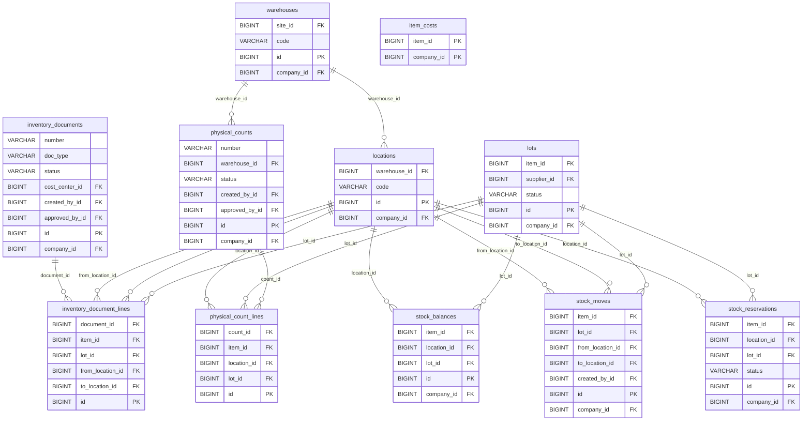

Relaciones con otros dominios: `inventory_document_lines` → items; `inventory_documents` → companies, cost_centers, users; `item_costs` → companies, items; `locations` → companies; `lots` → companies, items, parties; `physical_count_lines` → items; `physical_counts` → companies, users; `stock_balances` → companies, items; `stock_moves` → companies, items, users; `stock_reservations` → companies, items; `warehouses` → companies, sites.

## Calidad

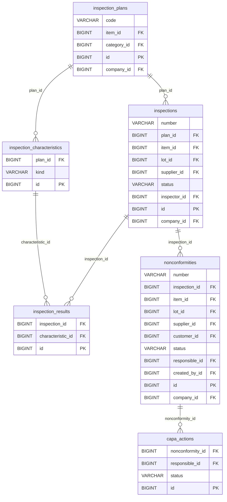

Relaciones con otros dominios: `capa_actions` → users; `inspection_plans` → companies, item_categories, items; `inspections` → companies, items, lots, parties, users; `nonconformities` → companies, items, lots, parties, users.

## Ventas y logística

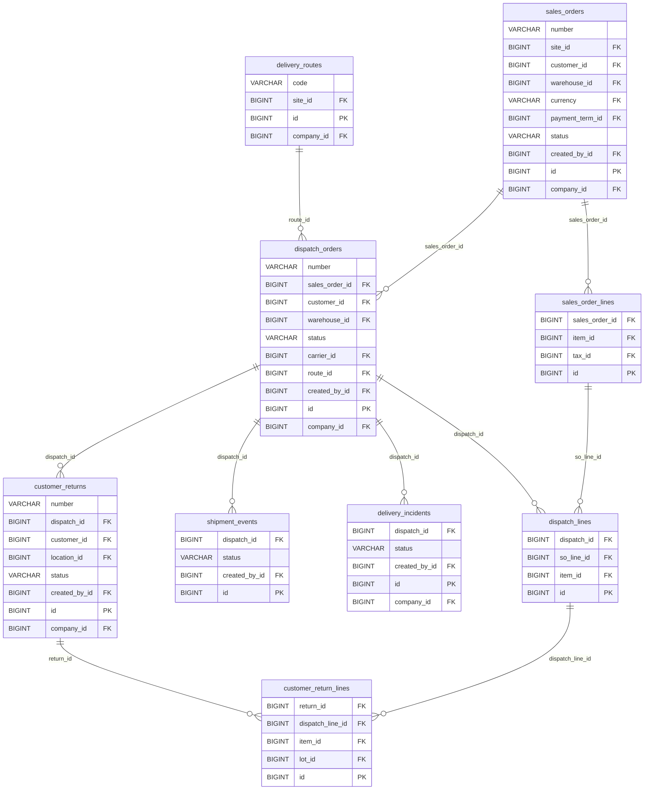

Relaciones con otros dominios: `customer_return_lines` → items, lots; `customer_returns` → companies, locations, parties, users; `delivery_incidents` → companies, users; `delivery_routes` → companies, sites; `dispatch_lines` → items; `dispatch_orders` → companies, parties, users, warehouses; `sales_order_lines` → items, taxes; `sales_orders` → companies, currencies, parties, payment_terms, sites, users, warehouses; `shipment_events` → users.

## Operaciones

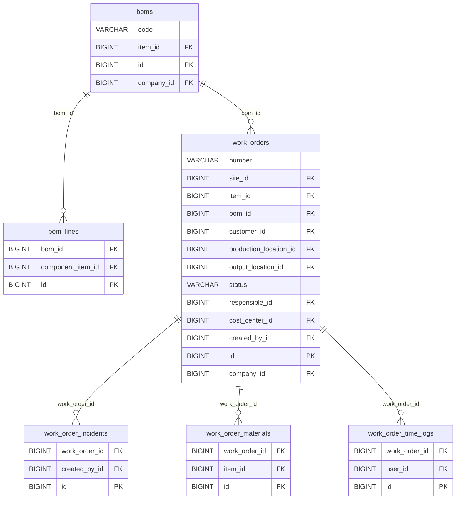

Relaciones con otros dominios: `bom_lines` → items; `boms` → companies, items; `work_order_incidents` → users; `work_order_materials` → items; `work_order_time_logs` → users; `work_orders` → companies, cost_centers, items, locations, parties, sites, users.

## Contabilidad y finanzas

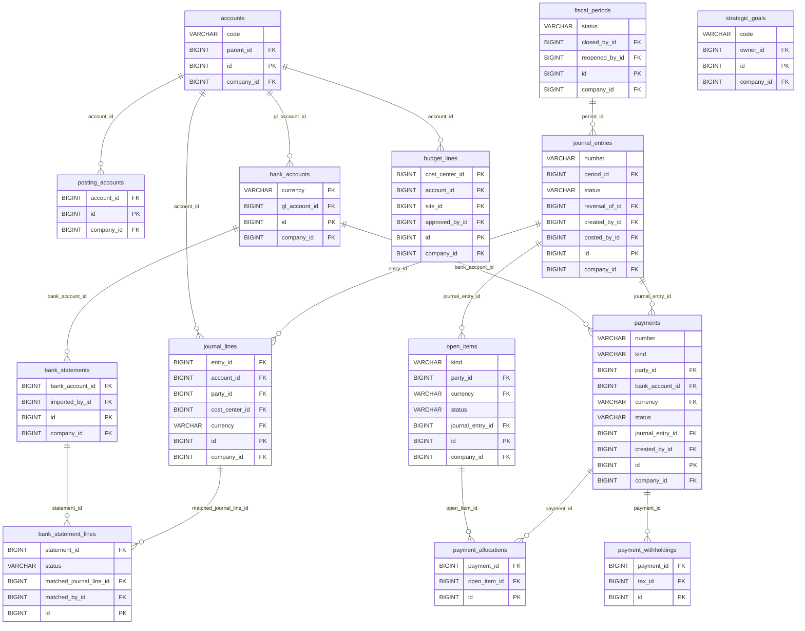

Relaciones con otros dominios: `accounts` → companies; `bank_accounts` → companies, currencies; `bank_statement_lines` → users; `bank_statements` → companies, users; `budget_lines` → companies, cost_centers, sites, users; `fiscal_periods` → companies, users; `journal_entries` → companies, users; `journal_lines` → companies, cost_centers, currencies, parties; `open_items` → companies, currencies, parties; `payment_withholdings` → taxes; `payments` → companies, currencies, parties, users; `posting_accounts` → companies; `strategic_goals` → companies, users.

## Facturación electrónica

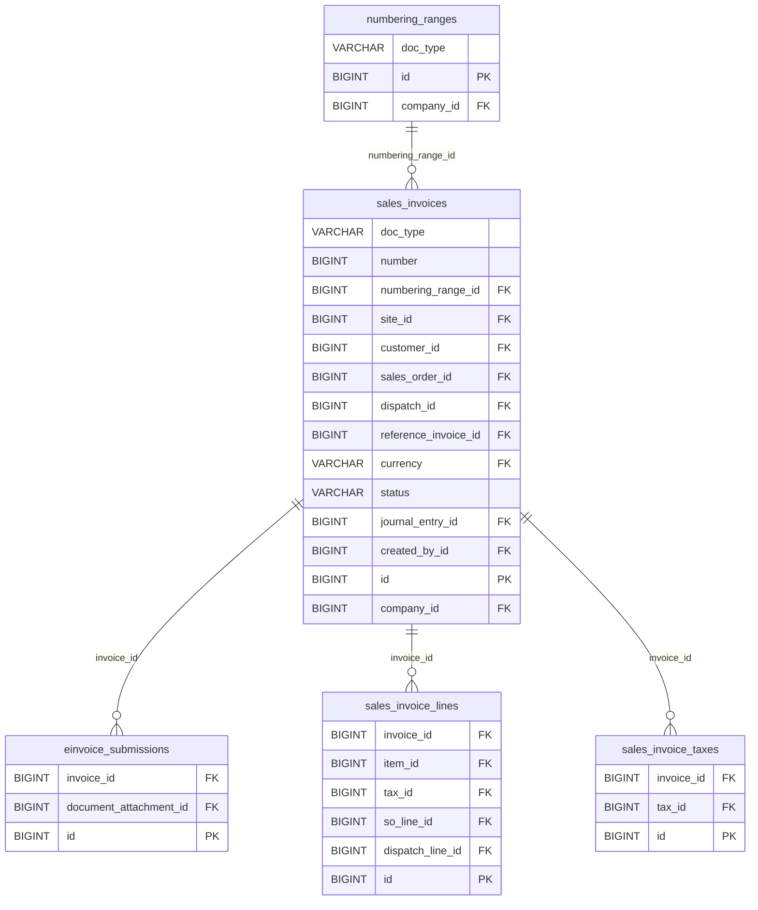

Relaciones con otros dominios: `einvoice_submissions` → attachments; `numbering_ranges` → companies; `sales_invoice_lines` → dispatch_lines, items, sales_order_lines, taxes; `sales_invoice_taxes` → taxes; `sales_invoices` → companies, currencies, dispatch_orders, journal_entries, parties, sales_orders, sites, users.

## Indicadores e importación

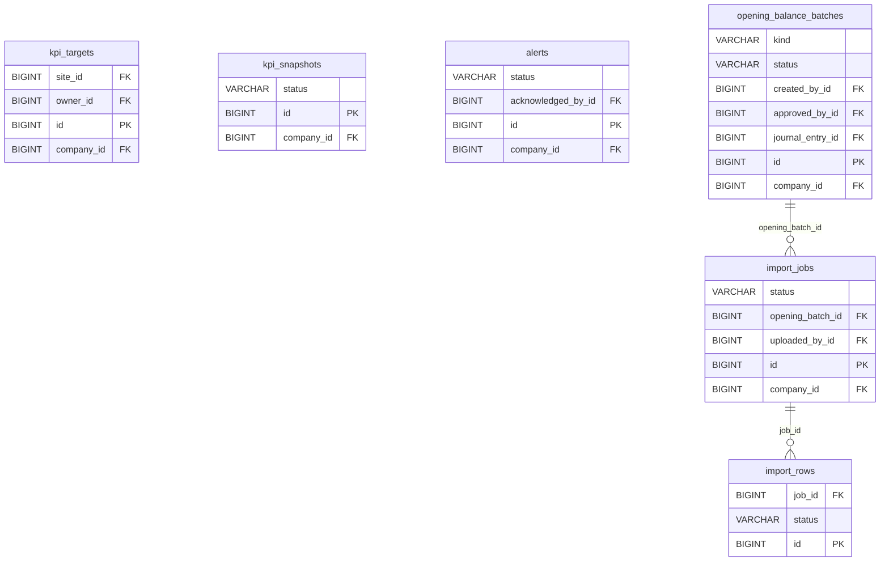

Relaciones con otros dominios: `alerts` → companies, users; `import_jobs` → companies, users; `kpi_snapshots` → companies; `kpi_targets` → companies, sites, users; `opening_balance_batches` → companies, journal_entries, users.
